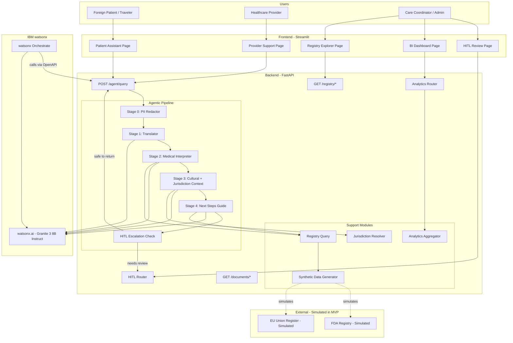
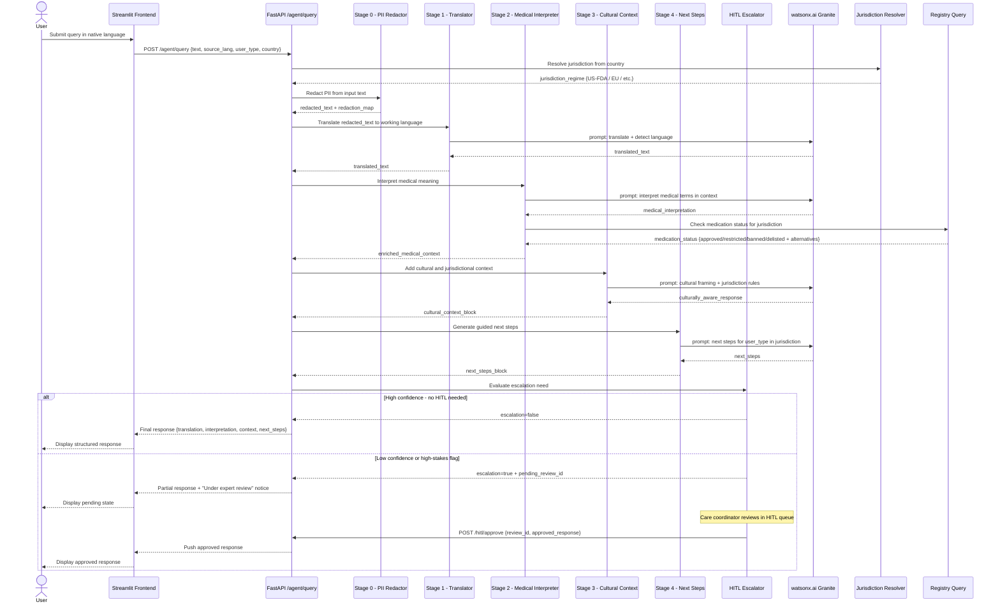

# Multilingual Clinical AI Agent & BI Platform — Architecture

> **Role**: Principal Healthcare Solutions Architect
> **Status**: MVP Implemented
> **Constraint**: Zero real PII; IBM watsonx.ai (`ibm/granite-4-h-small` · `/ml/v1/text/chat`) + watsonx Orchestrate; Python FastAPI backend; Streamlit multi-page frontend

---

## 1. Top-Level Overview

This document defines the modular MVP architecture for a multilingual, compliance-aware clinical AI agent and BI platform. The system serves three user groups:

| User Group | Primary Need |
|---|---|
| Foreign patients / international travelers | Understand consent forms, medication bans, billing terms in their native language |
| Healthcare providers / staff | Culturally sensitive communication prompts and local policy guidance |
| Care coordinators / admins | Multilingual BI dashboards for monitoring care delivery |

The core pipeline is **not a chatbot** — it is a staged agentic workflow:

```
Translate → Interpret Medical Meaning → Add Cultural/Jurisdictional Context → Guide Next Steps
```

Human-in-the-loop (HITL) review sits between agent output and end-user response for all high-stakes outputs. PII redaction is an inline pipeline stage, not a UI feature. The medication registry sync is a versioned, scheduled process from day one.

---

## 2. Monorepo Directory Structure

```
delabyrix/
│
├── backend/                          # FastAPI application
│   ├── main.py                       # App entrypoint, router registration
│   ├── config.py                     # Environment config (watsonx endpoints, model IDs)
│   ├── dependencies.py               # Shared FastAPI dependency injectors
│   │
│   ├── pipeline/                     # Agentic pipeline stages (one module per stage)
│   │   ├── __init__.py
│   │   ├── pii_redactor.py           # Stage 0: inline PII detection and redaction
│   │   ├── translator.py             # Stage 1: multilingual translation via Granite
│   │   ├── medical_interpreter.py    # Stage 2: medical meaning interpretation
│   │   ├── cultural_context.py       # Stage 3: cultural + jurisdictional context
│   │   ├── next_steps_guide.py       # Stage 4: guided next-steps generation
│   │   └── hitl_escalator.py         # HITL: escalation decision + queue management
│   │
│   ├── registry/                     # Medication registry module
│   │   ├── __init__.py
│   │   ├── models.py                 # Pydantic models for registry records
│   │   ├── sync.py                   # Scheduled sync logic (FDA + EU Union Register)
│   │   └── query.py                  # Registry query and status resolution
│   │
│   ├── jurisdiction/                 # Jurisdiction resolution module
│   │   ├── __init__.py
│   │   ├── resolver.py               # Determine applicable privacy/regulatory regime
│   │   └── rules.py                  # Jurisdiction rule definitions (US/EU/etc.)
│   │
│   ├── hitl/                         # Human-in-the-loop review service
│   │   ├── __init__.py
│   │   ├── queue.py                  # In-memory review queue (MVP: list; prod: Redis)
│   │   ├── models.py                 # Pydantic models for review items
│   │   └── router.py                 # FastAPI router: submit, list, approve, reject
│   │
│   ├── analytics/                    # BI analytics data pipeline
│   │   ├── __init__.py
│   │   ├── aggregator.py             # Aggregate anonymized interaction logs
│   │   └── router.py                 # FastAPI router: dashboard data endpoints
│   │
│   ├── synthetic/                    # Synthetic data generator
│   │   ├── __init__.py
│   │   ├── medication_registry.py    # Generate cross-border medication records
│   │   ├── consent_billing_docs.py   # Generate multilingual consent/billing docs
│   │   └── patient_logs.py           # Generate anonymized patient health/med/diet logs
│   │
│   ├── watsonx/                      # IBM watsonx integration layer
│   │   ├── __init__.py
│   │   ├── client.py                 # watsonx.ai REST client (ibm/granite-4-h-small)
│   │   └── orchestrate_adapter.py   # OpenAPI 3.0 contract bridge — 8 skills
│   │
│   └── routers/                      # FastAPI route definitions
│       ├── agent.py                  # POST /agent/query — main agentic pipeline entry
│       ├── registry.py               # GET/POST /registry/* — query, sync, changelog
│       ├── documents.py              # GET/POST /documents/* — consent docs + upload
│       ├── hitl.py                   # (re-exports from hitl/router.py)
│       └── analytics.py              # (re-exports from analytics/router.py)
│
├── frontend/                         # Streamlit multi-page application
│   ├── Home.py                       # Landing page — user group selector
│   └── pages/
│       ├── 1_Patient_Assistant.py    # Foreign patient interaction (pipeline chat)
│       ├── 2_Provider_Support.py     # Provider cultural communication prompts
│       ├── 3_HITL_Review.py          # Care coordinator HITL review queue
│       ├── 4_BI_Dashboard.py         # Care coordinator BI analytics dashboard
│       └── 5_Registry_Explorer.py   # Medication registry lookup and status
│
├── synthetic_data/                   # Generated synthetic datasets (gitignored output)
│   ├── medication_registry.json
│   ├── consent_docs/
│   │   ├── en/
│   │   ├── es/
│   │   └── hi/
│   └── patient_logs.json
│
├── orchestrate/
│   └── openapi_spec.yaml             # Exported OpenAPI 3.0 spec for watsonx Orchestrate
│
├── tests/
│   ├── test_pipeline.py
│   ├── test_registry.py
│   ├── test_synthetic.py
│   └── test_hitl.py
│
├── scripts/
│   ├── generate_synthetic_data.py    # One-shot synthetic data generation script
│   └── sync_registry.py              # Manual trigger for registry sync
│
├── requirements.txt
├── .env.example                      # Template — real .env is gitignored
├── .bobignore
├── AGENTS.md
├── idea.txt
└── architecture.md                   # This document
```

---

## 3. System Architecture Diagram



---

## 4. Agentic Workflow Sequence Diagram



---

## 5. Synthetic Data Generator — Specification

The synthetic data generator produces three categories of zero-PII test data.

### 5a. Cross-Border Medication Registry Records

Each record contains:

| Field | Type | Notes |
|---|---|---|
| `medication_id` | string | UUID |
| `name_generic` | string | INN name |
| `name_brand` | string | Trade name |
| `jurisdiction` | enum | `US_FDA`, `EU_EMA` |
| `status` | enum | `approved`, `restricted`, `banned`, `delisted` |
| `restriction_reason` | string | nullable |
| `therapeutic_alternatives` | list[string] | 1-3 alternatives by INN |
| `last_updated` | ISO8601 date | Registry sync timestamp |
| `source_registry` | string | `FDA Orange Book` / `EU Union Register` |

Approximately 50 synthetic records spanning both jurisdictions, with intentional cross-jurisdiction status differences (approved in EU, banned in US, etc.) to exercise the pipeline logic.

### 5b. Multilingual Consent & Billing Documents

Three document types in English, Spanish (`es`), and Hindi (`hi`):

- `consent_icu_admission` — Intensive care unit admission consent
- `consent_surgery` — Surgical procedure consent
- `billing_deductible_explanation` — Deductible and copayment explanation

Each document is a plain-text file with section markers. No real patient names or identifiers.

### 5c. Anonymized Patient Logs

Each log record contains:

| Field | Type | Notes |
|---|---|---|
| `patient_id` | string | Synthetic hash — not a real ID |
| `age_band` | enum | `18-30`, `31-45`, `46-60`, `61+` |
| `nationality` | string | ISO 3166 country code |
| `condition_codes` | list[string] | ICD-10 category codes only, no descriptions |
| `medications_current` | list[string] | INN names only |
| `diet_flags` | list[string] | e.g. `halal`, `vegan`, `gluten-free` |
| `interaction_language` | string | BCP-47 language tag |
| `visit_type` | enum | `ER`, `ICU`, `outpatient`, `telehealth` |

Approximately 200 synthetic patient log records.

---

## 6. API Endpoint Contracts

All endpoints are served by the FastAPI backend. Base URL: `http://localhost:8000`

### 6.1 Agentic Pipeline

#### `POST /agent/query`

**Purpose**: Main entry point for the full agentic pipeline.

**Request body**:
```json
{
  "text": "string — raw user input, may contain PII",
  "source_language": "string — BCP-47 tag, e.g. 'es', 'hi', 'en'",
  "user_type": "enum — patient | provider | coordinator",
  "country": "string — ISO 3166 alpha-2, e.g. 'US', 'DE', 'IN'",
  "session_id": "string — client-generated UUID for session continuity"
}
```

**Response body** (200 OK):
```json
{
  "session_id": "string",
  "pipeline_trace": {
    "jurisdiction": "string",
    "pii_redacted": "boolean",
    "translation": "string",
    "medical_interpretation": "string",
    "cultural_context": "string",
    "next_steps": "string"
  },
  "escalated": "boolean",
  "review_id": "string | null — present when escalated=true",
  "response_text": "string — final assembled response in source_language"
}
```

**Response body** (202 Accepted — when escalated):
```json
{
  "session_id": "string",
  "escalated": true,
  "review_id": "string",
  "status": "pending_review",
  "message": "string — localised notice to user"
}
```

---

#### `GET /agent/session/{session_id}`

**Purpose**: Poll for the result of an escalated query once HITL review is complete.

**Response body** (200 OK — approved):
```json
{
  "session_id": "string",
  "status": "approved | pending | rejected",
  "response_text": "string | null"
}
```

---

### 6.2 Medication Registry

#### `GET /registry/check`

**Purpose**: Check a medication's status in a given jurisdiction.

**Query parameters**:
- `medication_name` — string (INN or brand name)
- `jurisdiction` — `US_FDA` | `EU_EMA`

**Response body**:
```json
{
  "medication_id": "string",
  "name_generic": "string",
  "jurisdiction": "string",
  "status": "approved | restricted | banned | delisted",
  "restriction_reason": "string | null",
  "therapeutic_alternatives": ["string"],
  "last_updated": "ISO8601 date"
}
```

#### `GET /registry/list`

**Purpose**: Return full synthetic registry (paginated).

**Query parameters**: `page` (int, default 1), `page_size` (int, default 20), `jurisdiction` (optional filter)

**Response body**:
```json
{
  "total": "integer",
  "page": "integer",
  "records": ["array of registry record objects"]
}
```

---

### 6.3 Documents

#### `GET /documents/{doc_type}/{language}`

**Purpose**: Retrieve a synthetic consent or billing document.

**Path parameters**:
- `doc_type` — `consent_icu_admission` | `consent_surgery` | `billing_deductible_explanation`
- `language` — `en` | `es` | `hi`

**Response body**:
```json
{
  "doc_type": "string",
  "language": "string",
  "title": "string",
  "content": "string — full document text"
}
```

---

### 6.4 HITL Review Queue

#### `GET /hitl/queue`

**Purpose**: List all pending review items (care coordinator access).

**Response body**:
```json
{
  "pending_count": "integer",
  "items": [
    {
      "review_id": "string",
      "session_id": "string",
      "submitted_at": "ISO8601 datetime",
      "user_type": "string",
      "country": "string",
      "pipeline_trace": "object — same structure as /agent/query trace",
      "draft_response": "string"
    }
  ]
}
```

#### `POST /hitl/approve`

**Purpose**: Approve a draft response and release it to the user.

**Request body**:
```json
{
  "review_id": "string",
  "approved_response": "string — final edited response text",
  "reviewer_note": "string | null"
}
```

**Response**: `200 OK { "status": "approved" }`

#### `POST /hitl/reject`

**Purpose**: Reject and discard a draft response.

**Request body**:
```json
{
  "review_id": "string",
  "rejection_reason": "string"
}
```

**Response**: `200 OK { "status": "rejected" }`

---

### 6.5 Analytics

#### `GET /analytics/dashboard`

**Purpose**: Return aggregated, anonymized interaction metrics for BI dashboards.

**Query parameters**:
- `date_from` — ISO8601 date (optional)
- `date_to` — ISO8601 date (optional)
- `jurisdiction` — optional filter

**Response body**:
```json
{
  "total_queries": "integer",
  "escalation_rate": "float — 0.0 to 1.0",
  "queries_by_language": {"lang_code": "integer"},
  "queries_by_user_type": {"patient|provider|coordinator": "integer"},
  "top_medication_flags": [{"medication": "string", "status": "string", "count": "integer"}],
  "avg_pipeline_stages_completed": "float",
  "jurisdiction_breakdown": {"jurisdiction": "integer"}
}
```

---

### 6.6 Synthetic Data Generation

#### `POST /synthetic/generate`

**Purpose**: Trigger a fresh synthetic data generation run.

**Request body**:
```json
{
  "seed": "integer | null — for reproducibility",
  "medication_count": "integer — default 50",
  "patient_log_count": "integer — default 200"
}
```

**Response**: `200 OK { "status": "generated", "counts": { "medications": 50, "patient_logs": 200, "documents": 9 } }`

---

## 7. watsonx Orchestrate Integration

The `orchestrate/openapi_spec.yaml` file (v0.2.0) exports the following endpoints as skills for watsonx Orchestrate:

| Skill Name | Endpoint | Method |
|---|---|---|
| `clinical_query` | `/agent/query` | POST |
| `medication_check` | `/registry/check` | GET |
| `get_consent_document` | `/documents/{doc_type}/{language}` | GET |
| `analyze_document` | `/documents/analyze` | POST |
| `get_dashboard_metrics` | `/analytics/dashboard` | GET |
| `sync_registry_bulletin` | `/registry/sync` | POST |
| `get_registry_changelog` | `/registry/changelog` | GET |
| `get_registry_list` | `/registry/list` | GET |

The spec uses OpenAPI 3.0 format with `x-ibm-nl-intent` extension annotations on each operation to enable natural-language skill invocation inside Orchestrate. All operations carry a `snake_case` `operationId` and an LLM-friendly `description`.

Authentication in the OpenAPI spec uses an `apiKey` security scheme (header: `X-API-Key`). The actual key value is kept in `.env` and never committed.

**LLM**: `ibm/granite-4-h-small` via `/ml/v1/text/chat`.

---

## 8. HITL Escalation Rules

The HITL escalator triggers a review when any of the following conditions are met:

| Condition | Rationale |
|---|---|
| Watsonx model confidence score below threshold (0.70) | Uncertain outputs must not reach patients directly |
| Medication status is `banned` or `restricted` in the user's jurisdiction | High clinical risk |
| Input text contains PII patterns that could not be fully redacted | Privacy compliance |
| User query involves ICU admission, surgery consent, or end-of-life topics | High-stakes clinical decision context |
| Jurisdiction resolution is ambiguous (no clear match) | Cannot guarantee regulatory compliance |

---

## 9. Jurisdiction Resolution

The jurisdiction resolver maps the `country` field (ISO 3166 alpha-2) to a regulatory and privacy regime at the start of every pipeline call, before any LLM interaction. This ensures downstream stages always know:

- Which medication registry applies (FDA / EU EMA / other)
- Which privacy law applies (HIPAA, GDPR, other)
- Which cultural norms and terminology conventions to apply

The resolver is deterministic (no LLM call) — it uses a static lookup table in `backend/jurisdiction/rules.py`.

---

## 10. Privacy & Data Minimization

| Principle | Implementation |
|---|---|
| Zero real PII in development | All dev/test data is synthetic; generator runs locally |
| PII redaction before LLM calls | Stage 0 strips PII before any text reaches watsonx.ai — including user-uploaded documents (`POST /documents/analyze`) |
| Redaction map stored separately | Only the session manager holds the mapping; never logged |
| BI dashboards aggregate-only | Analytics pipeline never receives raw query text; `proactive_recommendations` contain only statistical aggregates |
| `.env` for all secrets | watsonx API key, project ID never in source control |
| HITL queue holds minimal data | SQLite-backed (`HITL_DB_PATH`); stores only pipeline trace and draft response, not raw input |
| Dynamic registry sync audited | Every `POST /registry/sync` call writes a versioned changelog entry with before/after field diffs |

---

## 11. New Capabilities

### 11a. Custom Document Upload & PII-Safe Clause Breakdown

**Endpoint**: `POST /documents/analyze`

Accepts a `.txt` or `.pdf` file upload. Pipeline:
1. Text extraction (`.txt` decoded UTF-8; `.pdf` text extracted via pypdf).
2. Stage 0 PII redaction — SSNs, emails, phone numbers, DOBs replaced with
   typed placeholders before the LLM sees any text.
3. `ibm/granite-4-h-small` clause analysis via `/ml/v1/text/chat`.
4. JSON response: `filename`, `detected_language`, `jurisdiction`,
   `pii_redacted` (bool), `redacted_preview` (first 500 chars), `analysis`.

Returns HTTP 400 for empty files, whitespace-only content, unsupported types
(`.docx` etc.), or corrupt PDF bytes.

### 11b. SQLite HITL Persistence

**Config**: `HITL_DB_PATH` (default: `data/hitl_queue.db`)

`HITLQueue` is backed by SQLite (WAL mode, thread-safe). Features:
- Review items survive server restarts.
- Parent directory created automatically.
- In-memory mode (`db_path=":memory:"`) used in tests for full isolation.
- Thread-safety tested with 50 concurrent enqueues.

### 11c. Dynamic Registry Sync & Changelog

**Endpoints**: `POST /registry/sync`, `GET /registry/changelog`

`apply_bulletin(medication_id, source, updates)` applies a field-level diff
to a registry record and writes a versioned changelog entry:
- `sync_version`: monotonically incrementing (`v1`, `v2`, …).
- `changes`: list of `{field, old_value, new_value, medication_id}` diffs.
- `last_updated` is always stamped.
- Immutable fields (`name_generic`, `name_brand`) are rejected with HTTP 400.
- Unknown fields are silently skipped.

`GET /registry/changelog?limit=N` returns entries newest-first.

### 11d. Zero-PII Proactive Care Pattern Analytics

**Field**: `proactive_recommendations` in `GET /analytics/dashboard` response.

`_build_proactive_recommendations(patient_logs)` scans anonymized patient logs
and generates zero-PII pattern insights in three categories:
- `dietary` — dietary flags (halal, kosher, etc.) appearing ≥ 2 times.
- `icd10_cluster` — ICD-10 chapter codes appearing ≥ 2 times, with
  human-readable chapter labels (e.g. "E00-E89 → Endocrine & Metabolic").
- `medication_conflict` — medications flagged as banned/restricted in at least
  one jurisdiction, appearing ≥ 2 times.

Results are sorted by `magnitude` (patient count) descending. No patient IDs,
SSNs, or raw text appear in any recommendation field.

---

## 12. Phased Implementation Todo List

### Phase 1 — Project Scaffold & Synthetic Data

- [ ] Initialize monorepo directory structure as defined in Section 2
- [ ] Create `requirements.txt` with FastAPI, Uvicorn, Streamlit, ibm-watsonx-ai, pydantic, pytest, faker
- [ ] Create `.env.example` with all required environment variable names (no values)
- [ ] Implement `backend/synthetic/medication_registry.py` — generate 50 cross-border medication records
- [ ] Implement `backend/synthetic/consent_billing_docs.py` — generate 9 multilingual documents (3 types x 3 languages)
- [ ] Implement `backend/synthetic/patient_logs.py` — generate 200 anonymized patient log records
- [ ] Implement `scripts/generate_synthetic_data.py` — write generated data to `synthetic_data/`
- [ ] Write tests for synthetic data generators in `tests/test_synthetic.py`

### Phase 2 — Jurisdiction Resolver & Registry Module

- [ ] Implement `backend/jurisdiction/rules.py` — static lookup table (ISO 3166 -> regime)
- [ ] Implement `backend/jurisdiction/resolver.py` — deterministic jurisdiction resolution
- [ ] Implement `backend/registry/models.py` — Pydantic models for medication records
- [ ] Implement `backend/registry/query.py` — query synthetic medication registry by name and jurisdiction
- [ ] Implement `backend/registry/sync.py` — scheduled stub that reloads registry JSON from `synthetic_data/`
- [ ] Write tests in `tests/test_registry.py`

### Phase 3 — watsonx Integration Layer

- [ ] Implement `backend/watsonx/client.py` — wrap ibm-watsonx-ai SDK calls for `ibm/granite-4-h-small`
- [ ] Implement `backend/config.py` — load watsonx project ID, API key, endpoint from `.env`
- [ ] Validate connectivity: test client can call watsonx.ai and receive a response
- [ ] Implement `backend/watsonx/orchestrate_adapter.py` — thin adapter that formats requests for Orchestrate compatibility

### Phase 4 — Agentic Pipeline

- [ ] Implement `backend/pipeline/pii_redactor.py` — Stage 0: regex + pattern-based PII redaction
- [ ] Implement `backend/pipeline/translator.py` — Stage 1: translation prompt to Granite
- [ ] Implement `backend/pipeline/medical_interpreter.py` — Stage 2: medical meaning + registry check
- [ ] Implement `backend/pipeline/cultural_context.py` — Stage 3: cultural framing prompt to Granite using jurisdiction output
- [ ] Implement `backend/pipeline/next_steps_guide.py` — Stage 4: next steps prompt to Granite by user_type
- [ ] Implement `backend/pipeline/hitl_escalator.py` — evaluate escalation conditions, write to HITL queue
- [ ] Wire pipeline stages in `backend/routers/agent.py`
- [ ] Write tests in `tests/test_pipeline.py`

### Phase 5 — HITL Review Service

- [ ] Implement `backend/hitl/models.py` — Pydantic models for review items
- [ ] Implement `backend/hitl/queue.py` — in-memory review queue with thread-safe operations
- [ ] Implement `backend/hitl/router.py` — GET /hitl/queue, POST /hitl/approve, POST /hitl/reject
- [ ] Write tests in `tests/test_hitl.py`

### Phase 6 — Analytics & Remaining API Routers

- [ ] Implement `backend/analytics/aggregator.py` — aggregate anonymized interaction log entries
- [ ] Implement `backend/analytics/router.py` — GET /analytics/dashboard
- [ ] Implement `backend/routers/registry.py`, `routers/documents.py`
- [ ] Register all routers in `backend/main.py`
- [ ] Verify all API endpoint contracts match Section 6

### Phase 7 — Streamlit Frontend

- [ ] Implement `frontend/Home.py` — user group selector landing page
- [ ] Implement `frontend/pages/1_Patient_Assistant.py` — pipeline chat interface for patients
- [ ] Implement `frontend/pages/2_Provider_Support.py` — provider prompt interface
- [ ] Implement `frontend/pages/3_HITL_Review.py` — HITL queue review UI for coordinators
- [ ] Implement `frontend/pages/4_BI_Dashboard.py` — BI metrics charts from `/analytics/dashboard`
- [ ] Implement `frontend/pages/5_Registry_Explorer.py` — registry search and status display

### Phase 8 — watsonx Orchestrate Export

- [ ] Write `orchestrate/openapi_spec.yaml` — OpenAPI 3.0 spec covering 8 Orchestrate skills
- [ ] Annotate each operation with `x-ibm-nl-intent` for Orchestrate natural-language invocation
- [ ] Validate spec with OpenAPI linter (see `tests/test_openapi_validation.py`)

### Phase 9 — Integration Testing & Hardening

- [ ] End-to-end pipeline test: patient query in Spanish -> full pipeline -> response in Spanish
- [ ] HITL escalation test: submit a banned-medication query, verify it enters review queue
- [ ] BI dashboard test: verify no raw text appears in analytics response
- [ ] PII redaction test: verify Stage 0 strips known PII patterns before watsonx call
- [ ] Synthetic data refresh test: verify `/synthetic/generate` overwrites `synthetic_data/` correctly

---

## 13. Key Design Decisions

| Decision | Choice | Rationale |
|---|---|---|
| LLM | `ibm/granite-4-h-small` via `/ml/v1/text/chat` | Per constraint; appropriate size for structured medical prompting |
| Pipeline pattern | Sequential stages, not a single LLM call | Auditability, HITL insertion points, testability |
| HITL queue | SQLite (WAL mode) | Persistence across restarts; thread-safe; zero extra infrastructure; in-memory mode for tests |
| Document upload | `.txt` / `.pdf` only; PII-redacted before LLM | Covers the most common clinical document formats while enforcing Stage 0 |
| Registry sync | Versioned in-memory bulletins + changelog | Simulates real-world regulatory feed updates; auditable without external infra |
| Proactive analytics | Aggregate-only over anonymized logs | Zero PII; actionable care coordination insights without exposing patient data |
| Jurisdiction resolver | Deterministic static table | No LLM latency for a compliance-critical decision |
| PII redaction | Inline Stage 0 before all LLM calls | Privacy by design; applies to both pipeline queries and uploaded documents |
| Frontend | Streamlit multi-page | Fastest path to multi-role UI; no JS build tooling required |
| Analytics isolation | Separate aggregator; raw text never enters analytics | BI data pipeline and patient agent are architecturally separate per AGENTS.md |
| Secrets | `.env` only; `.env.example` committed | `.bobignore` already excludes `.env`; no credentials in source |
