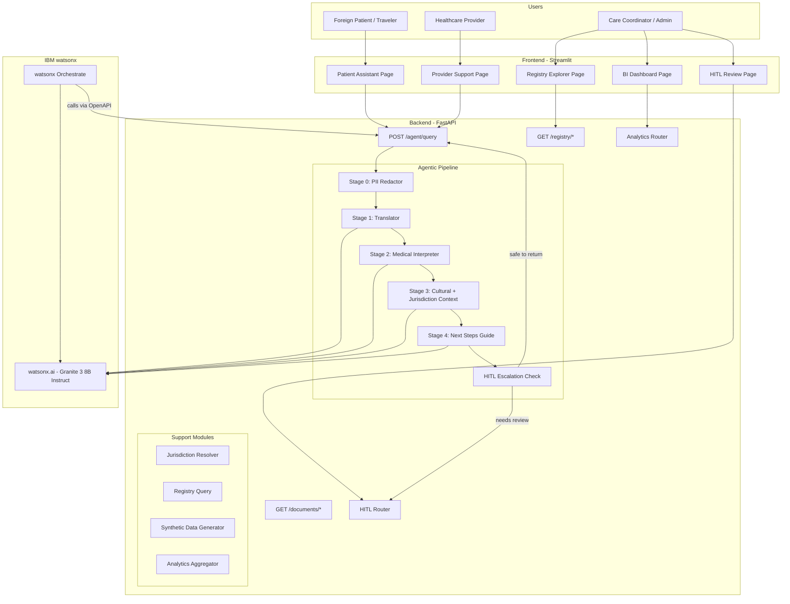
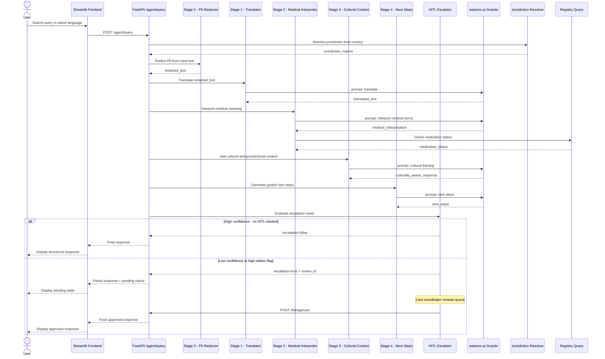

# @idea.txt Act asa Principal Healthcare Solutions Architect. Design a modular MVP architecture for our multilingual clinical AI agent and BI platform.Technical & Lab Constraints:
1. Run locally using a Python FastAPI backend and a Streamlit multi-page frontend, integrating with IBM watsonx.ai (using ibm/granite-3-8b-instruct) and IBM watsonx Orchestrate via an exported OpenAPI 3.0 YAML specification.
2. Zero real PII: design a synthetic data generator producing (a) dynamic cross-border medication registry records (US/FDA vs. EU Union Register: approved, restricted, banned, delisted + therapeutic alternatives), (b) multilingual consent & billing documents (English, Spanish, Hindi), and (c) anonymized patient health, medication, and dietary logs.
3. Build Human-in-the-Loop (HITL) escalation and PII redaction directly into the agentic pipeline (translate -> interpret medical meaning -> add cultural/jurisdictional context -> guide next steps).Deliverables for this planning task:
- Create `architecture.md` containing the complete directory structure, system architecture diagram (Mermaid), agentic workflow sequence diagram (Mermaid), API endpoint contracts, and a phased implementation todo list.
- Do NOT write application source code yet.

---

**Status:** active  **Date:** 2026-11-19

---

### 👤 User

@idea.txt Act asa Principal Healthcare Solutions Architect. Design a modular MVP architecture for our multilingual clinical AI agent and BI platform.Technical & Lab Constraints:
1. Run locally using a Python FastAPI backend and a Streamlit multi-page frontend, integrating with IBM watsonx.ai (using ibm/granite-3-8b-instruct) and IBM watsonx Orchestrate via an exported OpenAPI 3.0 YAML specification.
2. Zero real PII: design a synthetic data generator producing (a) dynamic cross-border medication registry records (US/FDA vs. EU Union Register: approved, restricted, banned, delisted + therapeutic alternatives), (b) multilingual consent & billing documents (English, Spanish, Hindi), and (c) anonymized patient health, medication, and dietary logs.
3. Build Human-in-the-Loop (HITL) escalation and PII redaction directly into the agentic pipeline (translate -> interpret medical meaning -> add cultural/jurisdictional context -> guide next steps).Deliverables for this planning task:
- Create `architecture.md` containing the complete directory structure, system architecture diagram (Mermaid), agentic workflow sequence diagram (Mermaid), API endpoint contracts, and a phased implementation todo list.
- Do NOT write application source code yet.

---

### 🤖 Assistant

> 🔧 called: use_skill

> 🔧 **use_skill** — create-plan

### 🤖 Assistant

> 🔧 called: read_file

> 🔧 **read_file** — d:\IBM_BOB\delabyrix\idea.txt

### 🤖 Assistant

> 🔧 called: spawn_subagent

Now I have full context from the `idea.txt`. Let me spawn a subagent to explore the workspace structure and understand what already exists.

> 🔧 **spawn_subagent** — explore

### 🤖 Assistant

> 🔧 called: update_todo_list

Confirmed — fully greenfield. I have everything I need to write the plan. Let me now compose the comprehensive `architecture.md` document.

> 🔧 **update_todo_list** — [-] Write architecture.md with directory structure, Mermaid diagrams, API contracts, and phased todo list
[ ] Validate plan completeness with user

### 🤖 Assistant

> 🔧 called: write_file

> 🔧 **write_file** — d:\IBM_BOB\delabyrix\architecture.md

### 🤖 Assistant

> 🔧 called: update_todo_list

> 🔧 **update_todo_list** — [x] Write architecture.md with directory structure, Mermaid diagrams, API contracts, and phased todo list
[-] Validate plan completeness with user

### 🤖 Assistant

[`architecture.md`](architecture.md) has been written. Here is a summary of what it contains, with the architecture diagrams rendered for your review.

---

## System Architecture

---

## Agentic Pipeline Sequence

---

## What's in `architecture.md`

| Section | Contents |
|---|---|
| **§2 Directory Structure** | Full monorepo tree — `backend/`, `frontend/`, `synthetic_data/`, `orchestrate/`, `tests/`, `scripts/` |
| **§3 System Architecture** | Mermaid component diagram (above) |
| **§4 Agentic Workflow** | Mermaid sequence diagram (above) |
| **§5 Synthetic Data Spec** | Schema for all three data categories — medication registry (50 records), multilingual docs (9 files), patient logs (200 records) |
| **§6 API Contracts** | Full request/response JSON for all 10 endpoints |
| **§7 Orchestrate Integration** | 4 exported skills, OpenAPI 3.0 spec location, `x-ibm-nl-intent` annotation strategy |
| **§8 HITL Escalation Rules** | 5 explicit trigger conditions |
| **§9 Jurisdiction Resolver** | Deterministic lookup strategy — no LLM for compliance-critical decisions |
| **§10 Privacy & Data Minimization** | 6 implementation principles |
| **§11 Phased Implementation** | 9 phases, 40 discrete todo items |
| **§12 Key Design Decisions** | 9 decisions with rationale |

---

**Three questions before you approve and move to implementation:**

1. The HITL escalation threshold is set at a model confidence score of **0.70** — does that feel right for MVP, or should it start higher (more conservative) for a healthcare context?

2. The HITL queue in Phase 5 uses an **in-memory list** for MVP simplicity. The document notes the upgrade path to Redis. Is that acceptable, or do you need file-based persistence (JSON on disk) so the queue survives a server restart during demos?

3. For the watsonx Orchestrate OpenAPI spec — are there additional endpoints beyond the four listed (`/agent/query`, `/registry/check`, `/documents/{type}/{lang}`, `/analytics/dashboard`) that should be exposed as Orchestrate skills?